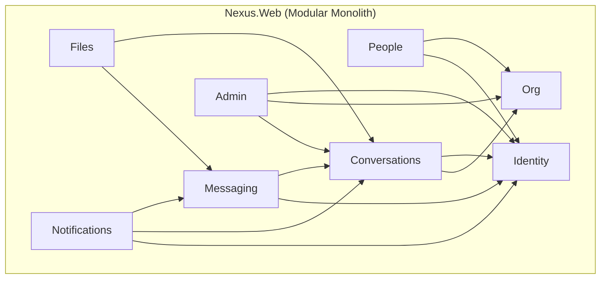

# Architecture

- Status: active
- Last updated: 2026-11-24
- Scope: system boundaries, modular monolith rules, runtime flows, and non-negotiable constraints.

This document is the single source of truth for architectural boundaries and runtime topology. Operational procedures live in [`MAINTAINER_GUIDE.md`](MAINTAINER_GUIDE.md); security policies in [`SECURITY_AND_AUTHZ.md`](SECURITY_AND_AUTHZ.md); messaging sync in [`SYNC_PROTOCOL.md`](SYNC_PROTOCOL.md); schema details in [`DATA_MODEL.md`](DATA_MODEL.md).

## 1. Architectural style and non-negotiable constraints

Nexus is a **same-origin modular monolith** targeting ~1,000 accounts and ~200 concurrent active users, built and maintained by a small team with a coding agent.

Mandatory constraints (from proposal §9.1 and accepted decisions):

1. **Modular monolith only.** Redis, microservices, CRM, AI, and unapproved infrastructure dependencies are out of scope.
2. **Single-origin BFF.** ASP.NET Core (`src/Nexus.Web`) serves the REST API, SignalR hubs, and the built React SPA (`src/Nexus.Client`) from the same origin.
3. **PostgreSQL is the single source of truth.** Authoritative state, Data Protection keys, sessions, idempotency keys, and the transactional outbox live in PostgreSQL. When using Supabase's connection pooler, use **Session Mode on port 5432**.
4. **Separate runtime and migration DB roles.** Application runtime connects with a least-privilege role; schema migrations run under a dedicated migration role (M0.2).
5. **Defense in depth across all transports.** Account status (`Active` vs `Disabled`) and resource authorization (`IAuthorizationService.Can`) are enforced on HTTP endpoints, SignalR hubs, file downloads, and sync/delta endpoints.
6. **Zero sensitive payloads in logs.** Message bodies, passwords, session cookies, and tokens are never logged.
7. **Server-held storage credentials.** Privileged object-storage credentials never leave the server. Client downloads are authorized server-side and streamed or issued short-lived signed URLs (`<= 60s`).
8. **Strict transport and browser security.** Enforce CORS (no `AllowAnyOrigin`), WebSocket `Origin` checks, TLS certificate validation, antiforgery, and CSP.

## 2. Module boundaries

All backend domain logic lives under `src/Nexus.Web/Modules/`:

Boundary rules:

- **Schema ownership:** A module owns its tables and mutations. Other modules read via explicit module services/queries or react asynchronously via the transactional outbox (M4.1), never by mutating another module's tables directly.
- **Authorization centralization:** Every state-changing or data-reading entry point calls `IAuthorizationService.Can(actor, action, resource)` (M0.4). Administrative roles (`SystemAdmin`, `HRAdmin`, `CommsAdmin`) do **not** bypass conversation membership checks.
- **Community → Channel hierarchy ([P0-D04](decisions/2026-11-23-p0-d04-community-channel-hierarchy.md)):** Communities own membership and roles (`Owner`, `Admin`, `Member`). Channels belong to exactly one community and inherit its membership/roles in MVP. DMs and group chats remain independent conversations with their own membership.
- **Chat and Organization boundaries ([P0-D14](decisions/2026-11-23-p0-d14-personal-chat-and-organizations.md)).** One account uses unified account-level Personal Chat (`organization_id = NULL`) across all active Workspaces and external contacts, and can belong to multiple isolated Organizations simultaneously in a single window without switching routes or reloading. Shared-workspace members can DM or group-chat directly without a connection request, and 1-on-1 DM history persists even if one leaves a Workspace. Each Organization strictly isolates its Directory, HR imports, Communities (`Shared Community` / `Private Community`), Channels, posts, and files by `organization_id` with immediate revocation on member removal. Membership owns the Organization role, employee verification, and Directory profile; credentials, TOTP, and sessions belong to the account.

## 3. Core runtime flows

### 3.1 HTTP API & SPA serving
1. Client loads the single-window SPA from `Nexus.Web` (`wwwroot/index.html` in Release; Vite dev proxy on `:5173` → `:5080` in Development).
2. Authenticated `FallbackPolicy` and `ActiveUserMiddleware` verify the session and `Active` account status. Organization routes (`/api/organizations/{orgId}/*`) also require an active membership in the Organization named in the path.
3. Endpoint checks `IAuthorizationService.Can(...)`, executes transactional work in PostgreSQL, and returns cursor-paginated responses (`<= 50` items).
4. Unmatched `/api/*` routes return HTTP `404`; unmatched client routes fall back to `index.html`.

### 3.2 Messaging & realtime sync (M2)
1. Client generates `client_msg_id`, displays an optimistic `pending` item immediately, and submits via HTTP (reused across retries).
2. In one PostgreSQL transaction: verify membership, enforce `UNIQUE(sender_id, client_msg_id)`, allocate `seq`, increment `change_seq`, persist message + `conversation_events` (+ outbox entry in M4).
3. After commit, the server reads eligible recipients from PostgreSQL and broadcasts via batched `Clients.Groups(...)` to `scope:{scopeId}:user:{userId}` groups (carrying `(conversationId, changeSeq, message?)` or community `delta?`). The single-window SPA connects to `/hubs/personal/messaging`, which joins both the account's Personal group and each active Organization group (`RefreshOrganizationSubscriptions`, `OrganizationAccessRevoked`).
4. Clients apply sequential `change_seq` payloads immediately and fetch authoritative deltas via `GET /changes?after=N` whenever a gap or reconnect occurs, advancing cursors only after local application. See [`SYNC_PROTOCOL.md`](SYNC_PROTOCOL.md).

### 3.3 Private file attachments (M3)
1. Two-stage upload: create pending attachment with `client_upload_id`, validate magic bytes, allowlist, and size limits, store under random object key.
2. Quarantine and scan via ClamAV (fail closed before real data).
3. Download endpoints check the account, scope and resource membership before streaming from private storage. Application download links repeat the checks on every request. Downloads use `Content-Disposition: attachment` and `X-Content-Type-Options: nosniff`.

### 3.4 Monitor and sandbox runs (M8.2 / M8.5)

Nexus.Web serves deployment-authorized telemetry and coordinates runs through PostgreSQL. The [independent runner decision](decisions/2026-11-24-m8-d01-monitor-runner-isolation.md) assigns Docker lifecycle and workload execution to `Nexus.LoadRunner`. It polls outbound over HTTPS and drives real application endpoints in a disposable sandbox. Run summaries and lifecycle events persist in PostgreSQL. Exported OpenTelemetry signals use a dedicated metrics backend.

## 4. Deployment topology (target M0.8 / M8.4)

- **Demo (M0.8):** Single containerized `Nexus.Web` serving API + SPA, connected to PostgreSQL (Data Protection keys and sessions persisted in DB) and private storage.
- **Pilot / Production (M8.4):** Always-on Docker Compose stack: `Nexus.Web`, PostgreSQL, Caddy (TLS termination), and ClamAV, running as non-root processes with automated encrypted offsite backups.
