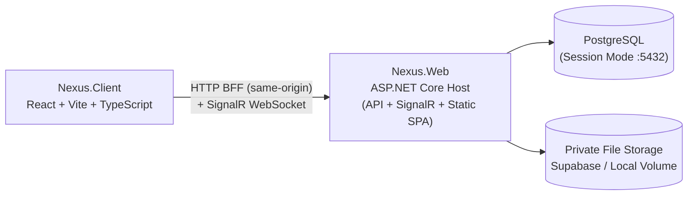

# Code Map — Read Before Grepping

- Status: active
- Last updated: 2026-11-23 (M0.1 baseline)
- Audience: a new AI session or engineer picking up a feature, bug fix, or review.

Use this map before running broad searches across the repository. Recommended lookup order:

1. **§1–§2** — repository structure, module graph, and runtime entry points.
2. **§3** — "task → starting file → test file" table.
3. **`docs/codemap/`** — machine-generated symbol/context/edge indexes (populated as modules grow from M0.2+).
4. **§4** — known pitfalls by area.

This file is a **navigation map**; it does not replace [`ARCHITECTURE.md`](ARCHITECTURE.md), [`MAINTAINER_GUIDE.md`](MAINTAINER_GUIDE.md), [`SECURITY_AND_AUTHZ.md`](SECURITY_AND_AUTHZ.md), or [`SYNC_PROTOCOL.md`](SYNC_PROTOCOL.md).

## 0. Search scope

Only `src/`, `tests/`, `scripts/`, `deploy/`, and active `docs/` are source of truth. Exclude generated and historical paths when searching:

| Path | What it is | Exclude from code search? |
|---|---|---|
| `src/Nexus.Web/bin`, `obj` | .NET build outputs | Always |
| `src/Nexus.Client/node_modules`, `dist` | npm packages and built SPA bundle | Always |
| `artifacts/` | Published host output (`dotnet publish`) | Always |
| `docs/archive/` | Historical proposals and audits | Yes (reference only, never source of truth) |
| `docs/mockups/` | Static HTML interaction prototypes | Yes (UI illustration only; backend enforces access) |

```powershell
rg -n "<pattern>" src tests -g "!**/bin/**" -g "!**/obj/**" -g "!**/node_modules/**" -g "!**/dist/**"
```

## 1. System and module graph



Feature modules inside `src/Nexus.Web/Modules/`:

| Module | Directory | Responsibility | Milestone |
|---|---|---|---|
| **Identity** | `src/Nexus.Web/Modules/Identity/` | Accounts, password auth, BFF sessions, TOTP MFA, Google OIDC linking, Active/Disabled & Verified/Unverified states | M1 |
| **Org** | `src/Nexus.Web/Modules/Org/` | Single Organization boundary, departments, branches, HR CSV import & employee matching | M1 |
| **People** | `src/Nexus.Web/Modules/People/` | Directory search (`unaccent`, `pg_trgm`), minimal profiles, custom status, avatars, blocking/reporting | M1 / M2 |
| **Conversations** | `src/Nexus.Web/Modules/Conversations/` | DMs (`dm_key`), group chats, communities, channels, membership, roles, official designation | M2 / M5 |
| **Messaging** | `src/Nexus.Web/Modules/Messaging/` | Messages, `seq`/`change_seq`, `conversation_events`, SignalR fanout (`user:{id}`), read state, reactions, polls, announcements | M2 / M5 / M6 |
| **Files** | `src/Nexus.Web/Modules/Files/` | Two-stage uploads, magic-byte checks, signed/streamed downloads, quotas, ClamAV quarantine/scan | M3 |
| **Notifications** | `src/Nexus.Web/Modules/Notifications/` | Transactional outbox worker, mentions, notification center, mute/quiet hours, Web Push (VAPID), email digest | M4 |
| **Admin** | `src/Nexus.Web/Modules/Admin/` | Account/role management, audit log, emergency ownership transfer, retention/break-glass, aggregate metrics | M7 |

## 2. Current runtime entry points (M0.1 / M0.3 / M0.4 / M0.6)

| File | Role |
|---|---|
| `src/Nexus.Web/Program.cs` | Minimal entry point calling `NexusHost.Build(args).Run()` |
| `src/Nexus.Web/NexusHost.cs` | Composition root: Security headers, Serilog request logging, static files, security defaults, operational endpoints, `/api/{**path}` 404 fallback, and SPA fallback |
| `src/Nexus.Web/Infrastructure/Security/SecurityDefaultsExtensions.cs` | Cookie auth, `FallbackPolicy`, strict CORS (rejects `*`), antiforgery, IP rate limiter, SignalR + `ActiveUserHubFilter`, Kestrel body limit |
| `src/Nexus.Web/Infrastructure/Security/ActiveUserMiddleware.cs` | Rejects `Disabled`/`Former` authenticated users on HTTP (`403`) |
| `src/Nexus.Web/Infrastructure/Security/ActiveUserHubFilter.cs` | Rejects `Disabled`/`Former` users on SignalR connect & every hub invocation |
| `src/Nexus.Web/Infrastructure/Security/WebSocketOriginMiddleware.cs` | Enforces same-origin / allowlisted `Origin` on WebSocket and `/hubs/*` paths |
| `src/Nexus.Web/Infrastructure/Security/NexusAuthorizationService.cs` | Centralized deny-by-default `IAuthorizationService.Can(actor, action, resource)` implementing `P0.2` |
| `src/Nexus.Web/Infrastructure/Security/PaginationGuard.cs` | Hard max page size (`50`) helper |
| `src/Nexus.Web/Infrastructure/Observability/ObservabilityExtensions.cs` | Serilog Compact JSON + OpenTelemetry tracing/metrics + health checks |
| `src/Nexus.Web/Infrastructure/Observability/SensitiveDataRedactingEnricher.cs` | Redacts message bodies, passwords, cookies, and tokens from all logs |
| `src/Nexus.Web/Infrastructure/Observability/HealthEndpoints.cs` | `GET /healthz`, `GET /readyz`, `GET /api/version` |
| `src/Nexus.Web/Infrastructure/Data/NexusDbContext.cs` | EF Core DbContext (`data_protection_keys`, `app_sessions`, `idempotency_keys`) + assembly config discovery |
| `src/Nexus.Web/Infrastructure/Data/DatabaseOptions.cs` | Separate `Runtime` vs `Migration` connection strings, TLS enforcement, rejects Supabase `:6543` |
| `src/Nexus.Web/Infrastructure/Data/DatabaseMigrator.cs` | Applies EF Core migrations strictly under `Migration` role (`dotnet run -- --migrate`) |
| `src/Nexus.Web/Infrastructure/Data/PostgreSqlSessionTicketStore.cs` | Server-side `ITicketStore` persisting BFF session tickets in PostgreSQL `app_sessions` |
| `src/Nexus.Web/Modules/Org/OrgEntities.cs` | Single `Organization`, `Department`, `Branch`, and `Employee` entities (`M1.1`) |
| `src/Nexus.Web/Modules/Org/HrCsvImportService.cs` & `OrgEndpoints.cs` | RFC-4180 HR CSV upsert with dry-run diff, `Unverified` match suggestions, and department list (`M1.9`) |
| `src/Nexus.Web/Modules/People/AvatarProcessor.cs` & `PeopleEndpoints.cs` | Vietnamese `unaccent` + `pg_trgm` directory search (`M1.10`), custom status (`UX-06`), and SkiaSharp 256×256 PNG avatar re-encoding (`M1.11`) |
| `src/Nexus.Web/Modules/Admin/AuditLogEntity.cs` | Append-only `audit_logs` entity (`M1.6` / `M7.1`) |
| `src/Nexus.Web/Modules/Identity/NexusUser.cs` | `NexusUser : IdentityUser<Guid>` + `AdminPasswordResetLinkEntity` (`M1.2` / `M1.5`) |
| `src/Nexus.Web/Modules/Identity/UsernameAndPasswordPolicies.cs` | `UsernamePolicy` (3–32 chars, reserved list) + `CommonPasswordValidator` (`>= 12` chars, `SEC-21`) |
| `src/Nexus.Web/Modules/Identity/IdentityEndpoints.cs` | `/api/auth/*` (register, login, logout, me, change/reset password, sessions, TOTP MFA) + `/api/admin/accounts/*` (`M1.3`–`M1.8`) |
| `src/Nexus.Web/Modules/Identity/IdentityBootstrapService.cs` | Default org creation + `--bootstrap-admin` CLI (`M1.1`) |
| `src/Nexus.Web/Infrastructure/Idempotency/IdempotencyEndpointFilter.cs` | `Idempotency-Key` endpoint filter (SHA-256 body hash, 24h TTL, replay, `409 Conflict`) |
| `src/Nexus.Web/Infrastructure/Idempotency/ConditionalTransition.cs` | Conditional `UPDATE ... WHERE` state-transition helper (`Succeeded` / `AlreadyInTargetState` / `Conflict` / `NotFound`) |
| `deploy/Dockerfile` | Multi-stage non-root container (`node:24-alpine` → `dotnet/sdk:10.0` → `dotnet/aspnet:10.0`) |
| `deploy/docker-compose.dev.yml` & `deploy/postgres/init-roles.sql` | Local PostgreSQL 17 + separate `nexus_migrator`/`nexus_runtime` roles + `Nexus.Web` stack |
| `src/Nexus.Web/Infrastructure/Storage/IFileStorage.cs` | Private storage contract, random object keys, path-traversal guards, `<= 60s` signed URL validation, safe download headers |
| `src/Nexus.Web/Infrastructure/Storage/LocalFileStorage.cs` | Atomic local-volume file storage outside `wwwroot` |
| `src/Nexus.Web/Infrastructure/Storage/SupabaseFileStorage.cs` | Server-side private Supabase Storage REST adapter |
| `src/Nexus.Web/Infrastructure/Storage/IFileScanner.cs` | Malware scan contract + `PrototypeFileScannerStub` (`skipped_prototype`) |
| `Directory.Build.props` | Roslyn security analyzers (`AnalysisModeSecurity=All`, security rules promoted to build errors) |
| `scripts/audit/Test-SecurityGuardrails.ps1` | Static security guardrails rejecting `AllowAnyOrigin`, disabled TLS validation, client storage secrets, and Supabase port `6543` |
| `.github/workflows/ci.yml` | CI workflow running build/test, Roslyn analyzers, `dotnet list package --vulnerable`, `npm audit`, Gitleaks, Trivy, and audit scripts |
| `src/Nexus.Client/vite.config.ts` | Dev server on `127.0.0.1:5173`, proxies `/api` to `http://127.0.0.1:5080` |
| `src/Nexus.Client/src/main.tsx` | React client bootstrap |
| `tests/Nexus.IntegrationTests/AuthorizationMatrixTests.cs` | 66 matrix-derived `[Theory]` cases verifying `IAuthorizationService.Can` |
| `tests/Nexus.IntegrationTests/SecurityDefaultsAndObservabilityTests.cs` | Integration tests for `FallbackPolicy`, `ActiveUserMiddleware`, `ActiveUserHubFilter`, WebSocket Origin, CORS wildcard rejection, CSP headers, pagination cap, and Serilog redaction |
| `tests/Nexus.IntegrationTests/StorageAndScannerTests.cs` | Integration tests for `LocalFileStorage`, `SupabaseFileStorage`, path traversal, signed URL TTL cap, safe download headers, and `PrototypeFileScannerStub` |
| `tests/Nexus.IntegrationTests/PostgresFoundationTests.cs` | Testcontainers PostgreSQL 17 tests verifying separate roles (`nexus_runtime` denied DDL), `IdempotencyEndpointFilter` (`SEC-19`), `ConditionalTransition`, Data Protection keys, PostgreSQL sessions, SignalR, and private PDF acceptance |
| `tests/Nexus.IntegrationTests/IdentityM1aTests.cs` | Testcontainers PostgreSQL 17 tests for `M1a` covering `SEC-01`, `SEC-08`, `SEC-16`, `SEC-20`, `SEC-20b`, `SEC-21`, `SEC-24`, `M1.7` devices, and `M1.8` RFC 6238 TOTP admin MFA |
| `tests/Nexus.IntegrationTests/DirectoryM1bTests.cs` | Testcontainers PostgreSQL 17 tests for `M1b` covering HR CSV dry-run/upsert/diff/match suggestions (`M1.9`), Vietnamese `unaccent`+`pg_trgm` directory search (`M1.10`), custom status, and SkiaSharp avatar re-encoding/EXIF stripping (`M1.11`) |
| `tests/Nexus.IntegrationTests/HostTests.cs` | xUnit integration smoke tests against `NexusHost` |

## 3. Task → starting file → verification

| If you need to... | Start here | Also check / test |
|---|---|---|
| Add or change an API endpoint or host middleware | `src/Nexus.Web/NexusHost.cs` or `src/Nexus.Web/Modules/<Module>/` | `tests/Nexus.IntegrationTests/`, [`SECURITY_AND_AUTHZ.md`](SECURITY_AND_AUTHZ.md), [`API_CONTRACTS.md`](API_CONTRACTS.md) |
| Change authorization policy or role rules | `docs/SECURITY_AND_AUTHZ.md` → `IAuthorizationService` (M0.4+) | Matrix-derived integration tests (`tests/Nexus.IntegrationTests/`) |
| Change messaging, ordering, retries, or SignalR sync | `docs/SYNC_PROTOCOL.md` → `Modules/Messaging/` & `Modules/Conversations/` | `SEC-17`, `SEC-18`, `SEC-19`, Playwright multi-device tests (`tests/e2e/`) |
| Add a database table or migration | `docs/DATA_MODEL.md` → EF Core DbContext & migrations (M0.2+) | Testcontainers PostgreSQL integration tests (separate runtime vs migration roles) |
| Update client UI or API calls | `src/Nexus.Client/src/` | `npm.cmd --prefix src/Nexus.Client run build`, [`design-system/README.md`](design-system/README.md) |
| Record a product/architecture decision | `docs/decisions/README.md` | Run `pwsh -File ./scripts/audit/Build-KnowledgeIndex.ps1` |
| Record a measured runtime or infra fact | `docs/facts/README.md` | Run `pwsh -File ./scripts/audit/Build-KnowledgeIndex.ps1` |

## 4. Known pitfalls by area

- **Same-origin SPA vs API fallback:** `/api/{**path}` must return `404` rather than falling through to `index.html`; otherwise missing API routes look like HTTP 200 HTML pages to the client.
- **Supabase pooler mode:** Always use **Session Mode on port 5432** (not Transaction Mode on 6543). See [`facts/postgres/supabase-pooler-session-mode-5432.md`](facts/postgres/supabase-pooler-session-mode-5432.md).
- **Prototypes are not specs:** `docs/mockups/*.html` illustrate UI flows only; never infer backend authorization rules from client markup. Always check [`SECURITY_AND_AUTHZ.md`](SECURITY_AND_AUTHZ.md).
- **Windows npm commands:** Use `npm.cmd` in PowerShell scripts and Windows instructions to avoid execution-policy friction on `npm.ps1`.
