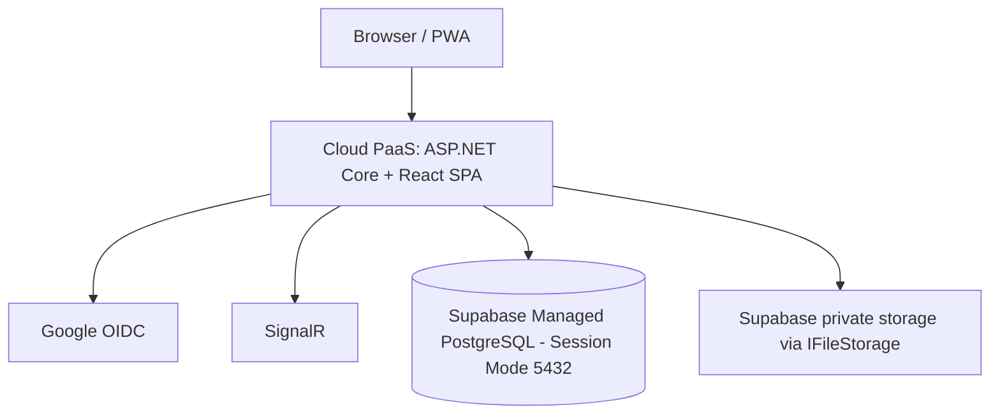

# PROJECT NEXUS — Product & Technical Proposal v0.3.1

> Your workplace. Connected.  
> Discussion draft for IT and implementation input for the coding agent, November 20, 2026. Historical proposal. For current product decisions, see the [decision log](docs/decision-log.md).

**Status:** The C# cloud-hybrid stack and core business policies had been selected at the time of writing. IT approval, benchmarking and a security audit were pending. This revision replaced v0.2 and incorporated decisions made since v0.3.

## 1. Executive summary

Nexus is an internal communication and community app for chat, feeds, announcements and document sharing. The first goal was to demonstrate a real connection between two users on two devices, at minimal cost and without access to enterprise servers.

- One primary developer experienced in C#, assisted by a coding agent.
- Fewer than 200 active users expected. Measure account counts and concurrent connections separately.
- Test a containerized ASP.NET Core app in the cloud with synthetic data. The same codebase can move to a company VM/server after approval.
- Target zero prototype spend. Production requires its own budget.
- CRM, HRM, ERP, workflows, enterprise data and AI are exploratory. Defer infrastructure for them until there is a confirmed requirement.
- Security, privacy, handover and recovery are acceptance criteria from the start.

## 2. Context and value

Slack Free supports interaction but limits history. Teams Free Communities had lifecycle concerns discussed in v0.2. Verify vendor policies before making procurement decisions. A custom application allows tailored workflows and data governance and requires funding for development, security updates, operations and support. Full parity with Slack or Teams is outside scope.

Measure successful connections, delivery to the right recipients, recurring usage, data protection and acceptable operating costs. The team can stop at the prototype or adopt an existing product if the benefits do not justify further investment.

## 3. Scope and priorities

| Area | Scope | Status |
|---|---|---|
| M01 First Connection | Google sign-in, directory, name search, request/accept, direct chat, PDFs, history and access tests | Defined |
| M02 Communication | Group chat, unread state, mentions, notifications and search | Planned |
| M03 Community | Work/social communities, feed, posts, comments, reactions and acknowledged announcements | Planned |
| Production | IT review, backup, monitoring, administration, pilot and handover | Required before real data or broad rollout |
| Self-hosting | Move from cloud to company infrastructure | Conditional |
| CRM/HRM/ERP/workflows/AI | Integration or modules for confirmed use cases | Exploratory |

Outside MVP: voice/video calls, native mobile apps, AI, workflow engines, a data warehouse, microservices, Kubernetes, Redis backplane, sharding, custom E2EE, link previews and global full-text search.

## 4. Milestone 01 — First Connection

**Demo:** A and B use separate Google test accounts. A finds B and sends an invitation. B accepts, both exchange greetings and B downloads the same sample PDF that A uploaded. The connection and history persist after logout and reconnect. A third account, C, exercises data isolation.

```mermaid
sequenceDiagram
    participant A as User A
    participant N as Nexus
    participant B as User B
    A->>N: Google sign-in and find B
    B->>N: Google Login
    A->>N: Request connection
    N-->>B: Notification
    B->>N: Accept
    N-->>A: Connected
    A->>N: Hello
    N-->>B: Hello (realtime)
    B->>N: Hi
    A->>N: Upload PDF
    N-->>B: Attachment available (M01: skipped_prototype; Prod: after scan)
    B->>N: Authorized download
```

### Definition of Done

- [ ] A and B sign in on different devices over HTTPS.
- [ ] Accounts outside the allowlist cannot access the directory or data.
- [ ] A finds B by name. Search returns only necessary directory fields.
- [ ] B sees the request. Only B can accept or decline.
- [ ] Accept creates exactly one connection and one DM under retries and races.
- [ ] Both users exchange greetings without refreshing.
- [ ] Disconnect, retry and reconnect cause no duplicate or missing messages in the test.
- [ ] Only the intended recipient can download the sample PDF. M01 uses download-only responses with `Content-Disposition: attachment` and `X-Content-Type-Options: nosniff`. The IFileScanner stub sets `scan_status = skipped_prototype`.
- [ ] C cannot read the DM, download its file or receive events for A/B.
- [ ] Disabled accounts lose API, file and realtime access, including through old sessions.
- [ ] History survives sign-out/sign-in. Database records and files survive redeployment.
- [ ] No secrets in Git or the client. Provide run instructions and a trial backup/restore procedure.

M01 demonstrates technical feasibility. Use synthetic PDFs because the free-tier demo does not run malware scanning. Real contracts and employee records are outside its scope.

## 5. Selected architecture — C# cloud hybrid (option B)

### B. C# cloud hybrid for M01



- **Runtime:** Package ASP.NET Core, SignalR and the React SPA in one PaaS container, originally considering Render Free or Railway Free. Serve the SPA and API from one origin. The server holds sessions and authorizes each resource.
- **Sleeping services:** Prototype assumptions were approximately 15 minutes without inbound traffic on Render and 5–10 minutes without outbound traffic on Railway, subject to trial credits. Verify each provider separately. Sleep and redeploy interrupt SignalR and can cause cold starts. Demonstrate automatic reconnect.
- **Ephemeral disks:** Keep PDFs, session keys and the database off the disposable PaaS disk. Persist Data Protection keys and sessions in PostgreSQL to survive deployment or accept signing in again for the demo.
- **Database:** Use Supabase Session Mode (5432) for the persistent ASP.NET instance and EF migrations. Direct connections are an option for migrations where IPv6 is available. Session Mode supports IPv4 and prepared statements. Leave Transaction Mode (6543) out of M01. Bound Maximum Pool Size for the quota and require certificate-verified database TLS.
- Use Supabase for managed PostgreSQL and private storage. Nexus handles identity and realtime delivery. Disable the unused Data API (PostgREST) or revoke client access.
- **Storage:** Reusing Supabase reduces service registrations. The proposal noted that even free Cloudflare R2 required a payment card. C# calls storage behind IFileStorage using a server-side service_role that bypasses RLS. Authorize each file before accessing storage and keep this key out of frontend code.

### C. VPS or enterprise VM for pilot, production and self-hosting

Use the same ASP.NET container and codebase in docker-compose.yml with app, postgres, caddy for automatic HTTPS, a file volume or S3/NAS via IFileStorage, and ClamAV when memory permits. Separate production secrets, networking, backup, TLS and resource limits from development.

### A. Supabase-first alternative

Rejected for this team: maintaining business and access logic across RLS, PL/pgSQL and Edge Functions would risk a rewrite in C#. Operating the full Supabase stack (roughly ten containers) would also add complexity compared with the ASP.NET application and PostgreSQL.

## 6. Stack and technical principles

| Layer | Choice | Notes |
|---|---|---|
| UI | React, Vite, TypeScript, responsive PWA, optional Tailwind/shadcn | Build and serve on the ASP.NET Core origin |
| Backend | ASP.NET Core (.NET LTS), modular monolith | One backend process and language |
| Identity | Google OIDC, server-side session/BFF cookie, HR allowlist | Keep tokens out of JavaScript. Bind identity to issuer + sub |
| Data | PostgreSQL, EF Core and Npgsql | Session Mode 5432, verified TLS, migrations in Git |
| Realtime | SignalR | Database is authoritative. No Redis backplane planned at this scale |
| Files | IFileStorage for private Supabase storage or on-prem volume/NAS/S3 | IFileScanner stub returns skipped_prototype in M01. Pilot/production uses ClamAV (budget ≥3 GiB RAM for the scanner) |
| Authorization | Deny-by-default C# resource policies and a least-privilege database role | One policy implementation. Separate migration credentials |
| Deployment | HTTPS, PaaS for M01, Docker Compose on a VPS/VM for pilot and production | Use company-owned production accounts |
| Testing | xUnit, real PostgreSQL with Testcontainers, Playwright | Run A/B/C isolation tests in CI |

Organize one solution by feature: Identity, People, Connections, Chat, Files, Notifications and, later, Community. Start with simple project boundaries. API contracts hide storage details and credentials. The MVP has no need for Python, Go or Rust.

## 7. Data model and workflows

Minimum tables, with illustrative names:

| Table | Contents |
|---|---|
| employees / allowlist | Employee code, approved email, display name, department and employment status |
| users / profiles | Internal UUID, unique identity provider (issuer, sub), unique employee_id, account status |
| connection_requests | from, to, status, timestamps |
| connections | Unique normalized pair of users |
| conversations | DM/group, dm_key unique, next_sequence |
| conversation_members | user, conversation, last_read_sequence, left_at |
| messages | id, conversation_id, sequence, sender, client_msg_id, body, timestamps |
| attachments | message, object_key, filename, MIME, size, scan_status, checksum |
| notifications | Recipient, type, resource and read_at when needed |
| audit_events | Actor, action, resource, result and timestamp. Exclude bodies and tokens |

Separate employee profiles from sign-in identities. Keep historical profiles when access is disabled. Use stable UUIDs, UTC timestamps, uniqueness constraints, foreign keys and reviewed migrations. Start with simple Vietnamese name search and add unaccent/pg_trgm when needed.

### Connections

Pending requests can be accepted, declined or cancelled. An accepted connection can be removed. Only the recipient accepts. Create connection and DM atomically. Lock or constrain the user pair to resolve concurrent invitations. Limit spam. M01 requires acceptance before direct messaging. Define block/unfriend behavior before pilot. HR/Comms/Leadership exceptions belong to M02/M03.

### Messaging

Persist before acknowledging. Enforce unique(sender_id, client_msg_id) and authorize before returning an existing message on retry. A realtime event prompts an authorized API read. Allocate per-conversation sequence numbers within a row-locking transaction where commit order matters. A bigint identity alone is insufficient for a gap-free cursor. Reconcile on reconnect, focus and periodic sync. Defer edit/delete, unread and read receipts unless needed. Add durable jobs or an outbox when delivery requirements justify them.

### File sharing

Proposed sample PDF limit: 10 MB. Validate size, filename, format and magic bytes, disregard client MIME claims and generate random object keys. M01 uses download-only responses with Content-Disposition: attachment and X-Content-Type-Options: nosniff. Never render PDF/HTML inline on the application origin. IFileScanner marks synthetic demo files skipped_prototype. The proposal cites a ClamAV Docker minimum of 3 GiB RAM. Before real data, require quarantine → ClamAV → clean/reject and fail closed. Use a private bucket/volume and an authenticated C# endpoint that checks conversation access. Keep service_role and permanent public URLs out of the client. IFileStorage supports a later move to volume/NAS/S3.

## 8. Security & Privacy

### 8.1 Threat model

| Threat | Control |
|---|---|
| Internet outsiders | HTTPS, allowlist, rate limits and VPN/Access if required by IT |
| Authorized user requests another user's file | Resource authorization/RLS, private storage, IDOR tests |
| Account theft | Admin MFA, session expiry, revocation and offboarding |
| XSS, CSRF and WebSocket hijacking | Safe text rendering, CSP, antiforgery for cookie APIs and Origin checks on handshakes |
| Secret leakage | Server-side secrets, Gitleaks, rotation and exclusion of .env from Git |
| Malicious files | Type/size limits, quarantine, antivirus and isolated downloads |
| Insider or administrator | Least privilege, audit, approvals and separate development/production access |
| Data loss or ransomware | Independent encrypted backups and restore exercises |
| Dependency/supply-chain risk | Pin versions, scan dependencies, review CI and update regularly |

Cloudflare Access only protects routes that pass through it. Direct Supabase access needs its own controls. Check resource authorization on every hub method, reconnect, membership change and revocation. SignalR groups do not enforce access. Minimize push payloads and keep DM content out of external notification services. Use established encryption and password hash implementations.

### 8.2 Google Login

Request only openid, email and profile. Do not read Gmail or Drive or store Google passwords. Use a company OAuth client in production, exact redirect URIs, issuer/audience validation, nonce, state and framework PKCE. Verify email at linking, then identify by issuer + sub. Discard unused provider tokens. Personal Google accounts suffice for a demo. Prefer managed production identities where available. Personal Gmail requires an HR allowlist and approved email-change procedure. Verify current consent, publishing and quota requirements at setup. Basic sign-in was expected to carry no separate fee. Hosting, email and advanced MFA may cost extra.

### 8.3 Authorization (ASP.NET Core)

- Deny by default. Authorize resources on every API endpoint, hub method and file download.
- Use Secure, HttpOnly, SameSite=Lax cookies, antiforgery on mutation endpoints and Origin checks on WebSocket handshakes.
- Store sessions in PostgreSQL. Revoke access and disconnect existing SignalR connections when account status changes. Test concurrent broadcast and revocation.
- Use a least-privilege runtime database role separate from the superuser, schema owner and migration credentials. Disable the unused Supabase Data API.
- Keep Supabase service_role server-side and check conversation/file access before using it.
- System administrators have no default UI entitlement to read DMs.

### 8.4 Offboarding and work/personal communities

- **M01:** Implement and test Disabled for DMs. Revoke sessions, disconnect SignalR, block API/downloads and retain history per retention policy.
- **M03:** The original design proposed two community classes and two departure states assigned by HR.
  - Work communities are admin-created and organization-owned, including announcements, departments and projects.
  - Employees create personal communities, such as sports clubs or lunch groups. Retain them when their creator leaves. Encourage an active co-owner.
  - Former was proposed for routine departures. Remove the user from all work communities, retain personal communities and existing DMs, display a mandatory Former employee badge, hide the directory entry and block new invitations. Revoke sessions to require fresh authorization. Warn when a group includes former employees, prohibit confidential documents in personal groups and optionally restrict uploads to images.
  - Disabled revokes all access for disciplinary, sensitive-role, security or account-closure cases. Revoke sessions, disconnect SignalR, deny login and remove memberships while leaving other members' groups intact.
- Check account state before membership on each request/hub call. Preserve history. Nexus cannot disable a personal Google account. Admin/HR users on personal Gmail should use an additional Nexus TOTP/passkey factor in production.

### 8.5 Privacy & governance

Collect only necessary names, emails, departments, optional avatars, work content, files and limited security logs. Phone contacts, location, microphone, camera and mailbox access require a defined feature and permission. Avoid unnecessary tracking or advertising. Publish purpose, retention, admin access, storage location, contacts and incident procedures.

HTTPS and at-rest encryption do not prevent a database administrator from reading data. Do not claim DM E2EE. IT controls approved, audited privileged production access. The company owns the repository, domain, OAuth project, hosting and backups. Use synthetic data in dev/staging. Obtain approval before uploading real data. IT and legal determine applicable privacy and cross-border transfer requirements.

### 8.6 Security standards and DDoS responsibilities

- Application/API: OWASP ASVS Level 1 for M01 and a Level 2 target before production. Use OWASP Top 10, API Security Top 10 (especially BOLA/IDOR) and WSTG, mapped to SEC-01 through SEC-16.
- Protocols/infrastructure: OAuth 2.0/OIDC with PKCE and verified TLS 1.2+/1.3 for HTTP and PostgreSQL. Apply relevant CIS hardening on VMs: non-root containers, least-privilege database roles and a default-deny firewall.
- IT/legal must confirm Vietnamese privacy obligations, including notice, minimization and overseas hosting/transfers, before pilot.
- ISO 27001/SOC 2 certification, ASVS Level 3 and E2EE are outside the commitment.
- Apply separate controls at application and network layers.
  - In ASP.NET Core, use Microsoft.AspNetCore.RateLimiting per user/IP, hub filters for message rates, MaximumReceiveMessageSize, MaxRequestBodySize and request timeouts (SEC-12).
  - Assign large volumetric Layer 3/4/7 attacks to infrastructure protection, such as the PaaS or an optional Cloudflare proxy. The original internal production proposal places the app behind VPN/Zero Trust to close public Internet access.

## 9. Security acceptance matrix

| ID | Scenario | Required outcome |
|---|---|---|
| SEC-01 | Anonymous API access | No private data |
| SEC-02 | Email outside allowlist | No application access |
| SEC-03 | C requests A/B's DM by ID | Denied |
| SEC-04 | C downloads PDF by URL/ID | Denied |
| SEC-05 | C subscribes to A/B's conversation | No private content |
| SEC-06 | A accepts their own request | Denied |
| SEC-07 | User changes role or sender identity | Denied |
| SEC-08 | Disable account with open tab | API, hub and file access revoked |
| SEC-09 | Expired token/session | No unauthorized access |
| SEC-10 | XSS, CSRF or invalid Origin | Controls hold in tests |
| SEC-11 | Wrong file type, oversized or unscanned upload | Block or quarantine |
| SEC-12 | Request flood | Rate limits apply |
| SEC-13 | Scan Git, frontend and container | No secrets, serious vulnerabilities addressed |
| SEC-14 | Restore database and files | Metadata and files match verified checksums |
| SEC-15 | Retry, reconnect and concurrent operations | No duplicate or missing test messages |
| SEC-16 | Revoke access during broadcast | No further data delivery beyond the defined revocation boundary |

Tools: Playwright, xUnit, Testcontainers, Gitleaks, Trivy, dependency auditing and OWASP ZAP on authorized staging. Load-test with real SignalR clients. Use ASVS as a checklist with a Level 2 production target subject to IT review. A clean scan is not certification. Obtain independent review and resolve or formally accept Critical/High findings. Retain evidence, commit, environment and retest results.

### 9.1 Guardrails for agent-assisted development

Apply five layers of checks starting in M00.

1. **Secure application defaults**
   - RequireAuthenticatedUser via FallbackPolicy and explicitly mark public endpoints with AllowAnonymous.
   - Check account status on each request/hub method using ActiveUserMiddleware and ActiveUserHubFilter.
   - Route conversation, message and file access through ConversationGuard.EnsureMemberAsync.
   - Enforce maxPageSize = 50 and paginate collections.
2. **Developer-owned security tests**
   - Implement SEC-01 through SEC-16 using xUnit, real PostgreSQL via Testcontainers and Playwright. Agents must not weaken or remove security tests to pass a build.
   - Before pilot, measure 200 concurrent SignalR connections, message sends and reconnect bursts with k6/NBomber.
3. **CI checks**
   - Run Gitleaks, dotnet list package --vulnerable, npm audit and Trivy image scanning.
   - Configure Roslyn analyzers for concatenated SQL, disabled certificate checks and insecure cookie configuration.
   - Fail CI on AllowAnyOrigin, certificate-validation bypasses or a frontend service_role.
4. **Repository instructions**
   - Root AGENTS.md references the decision log and forbids weakening security tests, loosening CORS/TLS, introducing unapproved packages, adding Redis/microservices/CRM/AI or changing Session Mode 5432.
   - Implement small vertical slices, each with an endpoint and test.
5. **Developer review before merge**
   - Program.cs: auth/OIDC, cookies, CORS, rate limiting and Data Protection keys.
   - Authorization: ConversationGuard, ActiveUserHubFilter and policies.
   - Core transactions: AcceptConnection and SendMessage with next_sequence allocation.
   - File upload/download: IFileStorage, magic bytes, membership and attachment/nosniff headers.
   - EF migrations: indexes, unique constraints and data-loss prevention.

## 10. Capacity, cost and cloud hosting

Planning assumptions: 200 daily active users, 20 messages per person per day, 22 workdays per month, five average event recipients, 2 KB per message and 1 MB uploaded per user per day. These are estimates.

| Metric | Estimate |
|---|---:|
| Messages per day | 4,000 |
| Messages per month | 88,000 |
| Monthly sends and receives | 528,000 |
| Raw monthly message data | 176 MB |
| Monthly file growth | 4.4 GB |

Excludes indexes, WAL, backups, metadata, reactions, presence, typing and egress. Storage may fill before CPU saturates. Persist feed posts and read on demand. Measure sockets independently of active users, including multiple devices/tabs and simultaneous reconnects.

| Infrastructure | Prototype budget assumption | Verify before selection |
|---|---|---|
| B for M01: PaaS container, Supabase PG Session Mode 5432 and private Storage | Potentially $0 within free/trial quota | Sleep behavior (Render ~15 min inbound, Railway ~5–10 min outbound/credits), WebSocket, RAM, ephemeral disk and pool limits |
| C for pilot/production: Linux VPS | Small VPS estimated $5–25/month excluding backups and domain | VAT, region, actual CPU/RAM (≥8 GB with ClamAV), snapshots, IP and security operations |
| C on premises: company VM | Unknown, no current allocation | IT approval for resources, licenses, storage, networking, backup and owner |

Quotas change. Previous figures (500 MB Supabase Free database, 1 GB storage, R2 Standard 10 GB-month and a payment-card requirement) were unverified planning references. Check billing, alerts and spend limits before enabling services. Obtain budget before purchasing or upgrading.

A pilot starting point was a 4 vCPU/8 GB VM with SSD and separate storage as needed. Allow at least 3 GiB for ClamAV. Resize from measurements. A dedicated physical server purchase is unnecessary for this plan.

Proposed targets for IT approval: 200 concurrent connections plus reconnect burst, simple API p95 under 500 ms and message display p95 under two seconds in a specified environment. Measure errors and data loss. Separate cold and warm PaaS runs.

## 11. Original implementation and migration plan

| Stage | Goal | Infrastructure | Gate |
|---|---|---|---|
| M00 Foundation | ASP.NET/React, EF Core on Session Mode 5432, Google OIDC, storage and scanner stub, PaaS deploy | Local + cloud free tier | Login, one record, one SignalR event and one private PDF using synthetic data |
| M01 First Connection | Two users, request/accept, greeting and PDF | Cloud free tier within quota | §4 DoD and A/B/C isolation |
| M02 Communication | Groups, notifications, unread and search | Cloud within quota | Stable M01 |
| M03 Community | Feed, work/social groups, announcements and acknowledgments | Cloud staging | Confirmed workflows |
| IT gate | Demo, privacy/security assessment, cost and ownership | Staging | Go/no-go |
| Pilot | 10–20 real employees | Approved cloud or VM | Review, backup, revocation and incident response |
| Rollout | 50 to fewer than 200 active users | Approved infrastructure | Monitor adoption, quotas and support |
| Optional self-hosting | Migrate to company server/VM | On premises | Access and rehearsed migration |

Original full-time estimate with an experienced developer and AI assistance: one week for M00, three to four more for M01, four to six weeks each for M02/M03 and two to four weeks for hardening and the IT gate. Four to six months to production communication/community was a planning estimate subject to availability and approvals. Begin security and access testing in M01.

### Migration cloud → on-prem

1. IT provisions a VM, domain, TLS, network/VPN, storage, monitoring and administrative access.
2. Agree on downtime, RPO/RTO and PostgreSQL/extension versions. Encrypt backups and rehearse restoration separately.
3. Pause writes during migration. Export a consistent database/schema, including any identity/auth schema in use, and objects with a checksum manifest.
4. Deploy the same ASP.NET image, restore PostgreSQL and files, configure IFileStorage for volume/NAS/S3 and enable ClamAV via IFileScanner. The full Supabase stack is unnecessary.
5. Update secrets, OAuth redirect URIs, SMTP/push, DNS, proxy and certificates. Require fresh sign-in where appropriate. Control secret transfers.
6. Smoke-test A/B/C, record counts, DB/file checksums, auditing, permissions, reconnects and PDF downloads. Verify access outside the LAN under the VPN policy.
7. Cut over and monitor. Remove cloud data only after IT confirms success and the rollback period expires. Account for post-cutover writes in any rollback. Avoid independent writers on both systems.

Approved cloud hosting can remain in place. A fully offline requirement would need an internal identity provider instead of relying solely on Google OAuth.

## 12. Operations and handover

- Separate dev, staging and production, including secrets. Use a company repository, branch protection, CI and review. At least one IT reviewer is needed before production.
- Coordinate database/file snapshots or quiesce writes. Keep encrypted offsite backups and test restoration monthly in production. RPO 24 hours and RTO four hours are starting targets for IT approval and measurement. Free demos have no assumed SLA or complete backup.
- Monitor availability, errors, p95 latency, connections, database/file quotas, disk, scanner failures and backups. Alert the owner and exclude DM bodies, cookies and tokens from logs.
- Runbooks cover deploy, rollback, restore, key rotation, disabling users, incidents and dependencies. Someone besides the developer must demonstrate deployment and restoration.
- Start with a responsive PWA and in-app notifications. M02 adds Web Push. Check iOS Home Screen and notification permission requirements. Keep push payloads free of sensitive content. Consider native, Capacitor or MAUI after pilot evidence.
- The organization decides retention and deletion for messages, files, audit and backups. Future AI is not a reason for indefinite retention.

### IT review package

Provide a system diagram, threat model, data inventory/privacy notice, access matrix, test evidence, restore report, dependency inventory, costs, incident runbook, decision log and ownership list. ASVS can guide review. Make no unassessed certification or absolute security claims.

## 13. Original v0.3.1 decision log

| ID | Decision at the time | Status |
|---|---|---|
| D01 | Nexus, internal communication and community | Defined |
| D02 | M01: two users find each other, request/accept, exchange greetings and share a PDF | Defined |
| D03 | Cloud first, independent of current company servers | Defined |
| D04 | Prefer zero prototype budget, fewer than 200 active users | Planning constraint |
| D05 | CRM/HRM/workflows/AI exploratory | Defined |
| D06 | React, TypeScript, PostgreSQL and a modular monolith | Accepted |
| D07 | Option B: ASP.NET Core, SignalR, EF Core/Npgsql, Session Mode 5432, TLS and Supabase Storage via IFileStorage | Accepted |
| D08 | Google sign-in with personal Gmail and HR allowlist, unique (issuer, sub), registration closed | Original M01 decision. Production IdP subject to IT approval |
| D09 | Private, download-only synthetic PDFs with skipped_prototype scanner stub. ClamAV with ≥3 GiB before pilot | Accepted |
| D10 | M01 tests Disabled. M03 proposed Former (leave work groups, retain personal groups, mandatory Former employee badge) and fully Disabled | Operating process subject to HR/IT approval |
| D11 | Admin-created organization-owned Work communities and independently retained Personal communities. HR/Comms/Leadership could DM without connecting in M02/M03 | Original M02/M03 decision |
| D12 | PaaS provider, VPS/region, real data, retention, budget and ownership | Pending IT |

This log governed v0.3.1. For implementation today, use the [current decision log](docs/decision-log.md). The original constraints excluded Supabase-first, Transaction Mode 6543, M01 ClamAV and expanding M01 into CRM/HRM/AI.

### IT discussion agenda

1. Communication needs, existing pain points and stop/continue criteria.
2. HR allowlist, Former versus Disabled, and additional admin/HR MFA when using personal Gmail.
3. Permitted cloud data, acceptable regions and accountable data owner.
4. Availability of a VM (≥8 GB for app, PostgreSQL and ClamAV) and NAS after the demo. VPN, DNS, TLS and operator.
5. Pilot/production budget, development time, maintenance and backups.
6. Admin/HR permissions, DM privacy, personal communities with former employees, retention and file sharing.
7. Security reviewer, acceptance, handover and incident owner.
8. Confirm M01 scope and select Render or Railway for M00.

## 14. Possible future extensions

Possible stages: communication, workplace, integration, enterprise data and AI, contingent on validated demand. No AI architecture, budget or timeline has been approved. Select MVP infrastructure on current needs.

Keep module boundaries, stable UUIDs, migrations, timestamps, data ownership, access controls and file metadata. Defer empty CRM/HRM schemas, warehouses, vector databases, AI gateways and workflow engines until justified. Prefer integrating existing payroll/accounting APIs.

Potential executive AI queries include KPIs, approved documents, reports and analysis. Prefer read-only structured APIs, authorization filtering before retrieval, cited sources and accuracy checks. AI inherits the user's permissions. Leadership does not automatically gain access to DMs, and DMs are excluded by default. Classify data, evaluate local/cloud models, control prompt injection and tool permissions, and require human approval for consequential decisions. Forecasting needs validated models and adequate data quality.

## 15. References to verify at implementation time

- Supabase: https://supabase.com/pricing ; https://supabase.com/docs/guides/self-hosting ; https://supabase.com/docs/guides/database/postgres/row-level-security
- Cloudflare Pages: https://developers.cloudflare.com/pages/ ; R2: https://developers.cloudflare.com/r2/pricing/
- Render: https://render.com/docs/free ; Railway: https://docs.railway.com/
- ASP.NET Core/SignalR: https://learn.microsoft.com/aspnet/core/ ; https://dotnet.microsoft.com/platform/support/policy/dotnet-core
- Google OIDC: https://developers.google.com/identity/openid-connect/openid-connect
- OWASP ASVS: https://owasp.org/projects/asvs/ ; WSTG: https://owasp.org/www-project-web-security-testing-guide/
- PostgreSQL: https://www.postgresql.org/docs/ ; Docker Compose: https://docs.docker.com/compose/

These links are starting points for verification. This proposal did not confirm current pricing or provider settings.

---

**First success:** Two real users on different devices use synthetic data to find each other, connect, exchange greetings and share a PDF within the tested security boundary. Use the result to decide whether to invest further.
